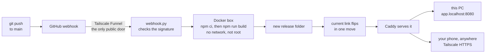
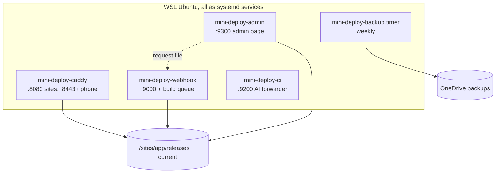

# mini-deploy
fun little deployment project hhe

A small self-hosted deploy platform, like a tiny Netlify on a home PC, built step by step to learn how deploys really work. It runs in WSL2 (Ubuntu) on Windows, in plain Python (standard library), Caddy, Docker and Tailscale.

## What happens when you push



A failed build never touches the live site. Every deploy is a new release, the last 5 are kept, and one click rolls back.

## What it can do

| | |
|---|---|
| **Ship** | Push to GitHub and the site goes live; static folders or projects with a build step; branch previews; upload a .zip; **Redeploy** button |
| **Undo** | Releases, one-click roll back / forward; after a rollback the app is held so a push cannot undo it |
| **Reach** | On this PC, on the home Wi-Fi, and on the phone from anywhere over your private Tailscale network |
| **Control** | Admin page (this PC only, password) with Bean the mug wizard, a live push track, release beans, AI use, backups; full build logs |
| **Protect** | Signed webhooks only, secrets masked and kept out of sites, AI spending brakes per app, a whole-system security review |
| **Recover** | Weekly secret-free backup to OneDrive with a tested restore; an incident runbook |

## Where things are



| Folder | What is in it |
|---|---|
| `scripts/` | the platform: `deploy.py`, `build.py`, `webhook.py`, `admin.py`, `ci_forwarder.py`, `backup.py`, `upload.py`, `repos.py`, and the eight test suites |
| `web/admin/`, `web/logs/` | the admin page and the build-log page |
| `web/theme/pink.css` | the shared look (copied into each site by `scripts/sync-theme.sh`) |
| `caddy/Caddyfile` | which address serves what |
| `systemd/` | the services and timers |
| `config/webhook.json` | listen address (repos are connected on the admin page instead) |
| `examples/static-site/` | the sample app the build tests use |
| `docs/status-log.md` | the full history: every step, review and lesson |
| `CLAUDE.md` | the rules and the handoff for the coding agent |

## Everyday commands (in WSL, from the repo)

```bash
bash scripts/test-all.sh --clean          # run all eight test suites, then clean up
python3 scripts/deploy.py list            # apps and their releases
python3 scripts/ci_forwarder.py usage     # AI use today per app
systemctl is-active mini-deploy-caddy mini-deploy-webhook mini-deploy-ci mini-deploy-admin
```

Admin page: `http://admin.localhost:8080` (this PC, Chrome or Edge). The owner's notes, guides and the incident runbook live in Obsidian (`Projects/Mini Deploy/`).
